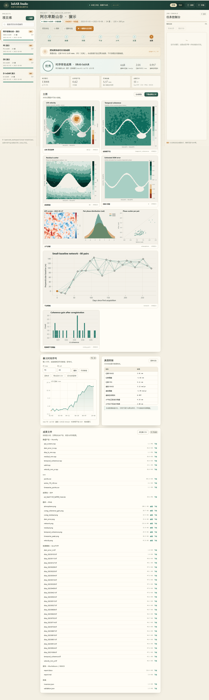
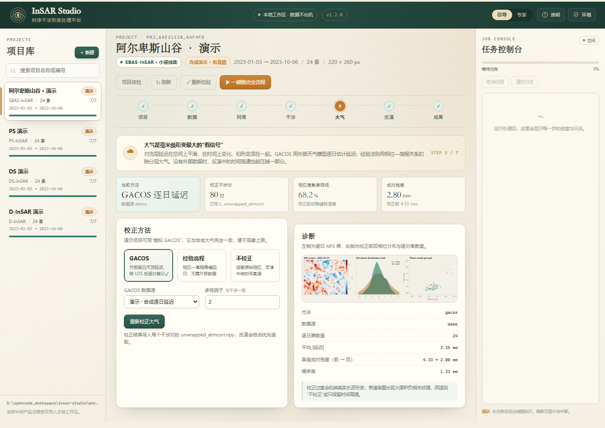

# InSAR Studio · 时序干涉形变处理平台

一个本地优先运行的 InSAR 时序形变处理工作台。它把「数据接入 → 配准 → 干涉网络 → 差分干涉 → 大气校正 → 时序反演 → 成果输出」串成一条可复现的处理链，并提供中文分步向导。演示数据可以用默认参数一键跑完；真实数据需先在外部工具完成 SAR 预处理，进阶用户可以在专家模式里调每一个关键参数。

支持四条技术路线：

| 路线 | 适用场景 | 最少影像 | 默认网络 |
| --- | --- | ---: | --- |
| **SBAS-InSAR** | 面状沉降、滑坡、城市形变，兼顾精度与覆盖 | 8 | 小基线集，最大时间基线 72 天 |
| **PS-InSAR** | 城市建筑、岩石裸露区，点目标时序监测（合成数据可验证毫米级趋势） | 8 | 单主影像星形 + 相邻对闭环 |
| **DS-InSAR** | 植被、裸土等低相干区 | 10 | 相位链接 + 分布式散射体联合解算 |
| **D-InSAR** | 同震、滑坡、单次事件的快速差分 | 2 | 单干涉对（可选日期） |

影像数不足时，导入、切换路线和启动全流程都会在开始处理前被拒绝，并提示该路线需要的最少景数。

PS 和 DS 是面向算法验证的简化实现：PS 只做振幅离差和相干性选点，DS 使用 EMI 相位链接与按 256 MiB（约 268 MB）预算分块计算的滑窗协方差；两者都不包含 StaMPS、MintPy 级别的完整逐点相位模型或分块优化。真实业务应与成熟实现交叉验证。

> 本项目是本地科研/教学与算法验证工具，不是经过计量认证的生产系统。真实业务请使用经严格验证的 SNAP / ISCE / Gamma / StaMPS 等生产链，并遵守数据许可与安全规范。



**文档**：[新手指南](docs/新手指南.md) · [用户手册](docs/用户手册.md) · [使用教程](docs/使用指南.md) · [技术说明](docs/技术说明.md) · [发布说明](RELEASE.md)

**仓库**：<https://github.com/20000627/insar-studio>

## 目录

- [快速开始](#快速开始)
- [真实案例](#真实案例)
- [四套演示与精度](#四套演示与精度)
- [七步工作流](#七步工作流)
- [数据接入](#数据接入)
- [技术路线与关键算法](#技术路线与关键算法)
- [大气校正](#大气校正)
- [默认参数](#默认参数)
- [成果文件](#成果文件)
- [项目目录结构](#项目目录结构)
- [命令行](#命令行)
- [测试](#测试)
- [常见问题](#常见问题)
- [限制与声明](#限制与声明)

## 快速开始

### 方式一：Windows 一键启动（推荐）

1. 确认已安装 **Python 3.9 – 3.11**（安装时勾选 “Add python.exe to PATH”）。
2. 双击项目根目录的 `start.bat`；只想检查环境时运行 `start.bat --check`。
   - `scripts/bootstrap.py` 会检查运行依赖；缺失时自动创建本地 `.venv` 并安装 `requirements.txt`（只需一次）。
   - 默认从 `8765` 起自动选择空闲端口，并自动打开浏览器；终端会打印实际地址。
   - 端口被占用不会导致启动失败，会自动顺延到下一个空闲端口。固定端口、禁用浏览器等参数见[命令行](#命令行)。
3. 在左侧「项目库」选择任意演示项目，或点击「+ 新建」创建新项目。
4. 进入「成果」步骤，点击「一键跑完全流程」，等待任务控制台显示「已完成」。

首次安装依赖需要联网；之后除在线下载、GACOS 官方申请/邮件导入和自定义在线 GACOS 外可离线运行。服务只监听 `127.0.0.1`，不会把数据暴露到局域网。

### 方式二：手动启动

```powershell
cd D:\path\to\insar-studio
python -m pip install -r requirements.txt
python -m insar_studio serve --open
```

默认从 `8765` 起自动选择空闲端口并打开浏览器；终端会打印实际地址。按 `Ctrl+C` 停止服务。需要固定端口时加 `--port 8765 --strict-port`；`--port 0` 表示交给操作系统分配。

### 第一次使用建议

1. 打开 `SBAS 演示` 项目，先看「成果」页的速率图、相干性图和时间序列。
2. 点「一键跑完全流程」，观察任务控制台和自动推进的步骤。
3. 新建一个演示项目，切换到 PS / DS / D-InSAR，比较不同路线的结果。
4. 再尝试导入自己的数据（见[数据接入](#数据接入)）。

第一次接触命令行和 InSAR 概念，请先读 [新手指南](docs/新手指南.md)。它从下载、校验、解压、启动讲到导入、跑通、看结果和备份。

## 真实案例

仓库内置两个可以直接跑通的真实数据案例。它们使用公开 CC-BY-4.0 产品派生的回放栈，不是原始 SLC 重处理，适合学习链路、核对参数和验证输出。

| 案例 | 路线 | 数据源 | 规模 | 结果 |
| --- | --- | --- | --- | --- |
| [定日 2025 地震 D-InSAR](examples/01_dingri_2025_dinsar/) | D-InSAR | Zenodo 14836721，升轨解缠相位 | 2 景，500 × 500 | 同震 LOS 形变图，与公开产品相关系数约 1.0 |
| [白格滑坡 SBAS](examples/02_baige_landslide_sbas/) | SBAS | Zenodo 10605366，位移时间序列 | 41 历元，51 × 95 | 速率图与时间序列，RMSE 约 0.20 mm |

每个案例目录都有逐步中文教程、`build_case.py`、`run_case.py`、`PROVENANCE.md` 和已生成的结果。总览见 [examples/README.md](examples/README.md)。

一条命令跑完：

```bash
python examples/01_dingri_2025_dinsar/scripts/run_case.py
python examples/02_baige_landslide_sbas/scripts/run_case.py
```

两个案例的 `data/` 和 `results/` 已随仓库提交。白格案例重建数据时需要额外安装 `h5py`。案例是派生回放栈，工作台不执行原始 TOPS SLC 的配准、去斜和 burst 拼接；真实生产请先用 SNAP / ISCE / Gamma 预处理。

## 四套演示与精度

演示数据是确定性合成的 Sentinel-1 风格 24 景时序栈（220 × 260 像元，2023-01-03 至 2023-10-06，12 天重访），包含已知形变、分层大气、DEM 误差、轨道 ramp、亚像元配准偏移和相干性变化。因此可以用真值定量检查整条链路，而不仅仅是“看起来能跑”。

当前版本对本机四套演示的回归结果：

| 路线 | 位移 RMSE | 速率 RMSE | 速率空间相关 | 综合评价 | 备注 |
| --- | ---: | ---: | ---: | --- | --- |
| SBAS | **1.85 mm** | **2.14 mm/yr** | 0.956 | 优秀 | 80 对，有效像元 91.0% |
| PS | **1.87 mm** | **3.44 mm/yr** | 0.936 | 优秀 | 45 对，42,326 个 PS 点 |
| DS | **2.52 mm** | **3.59 mm/yr** | 0.893 | 优秀 | 80 对，协方差按行块计算 |
| D-InSAR | **2.04 mm** | — | — | 优秀 | 单对，位移偏差 1.40 mm |

本机最近一次全流程回归耗时：D-InSAR 4.2 s、DS 18.1 s、PS 33.6 s、SBAS 17.3 s；四套项目体检均为 0 错误，每项 1 条预期地理编码警告（演示数据无轨道）。耗时随机器性能、磁盘和后台扫描变化，仅作量级参考。

合成数据只能验证算法链路与数值实现，**不代表真实场景精度**。真实数据的精度取决于影像质量、轨道、DEM、配准、解缠和大气校正质量。



## 七步工作流

界面顶部是固定的七步导航，每一步都有「引导」说明；右侧「专家」开关会展开更多参数。

### 任务控制台与结果一致性

- 处理任务在后台线程执行，同一项目同时只允许一个任务；重复提交会被拒绝（HTTP 409），界面会提示已有任务在运行。
- 任务运行中可以「取消任务」；刷新页面后若任务仍在运行，页面会自动重连并继续显示进度。
- 修改参数或切换技术路线不会打断正在运行的任务；路线切换在任务内部生效，并重新套用该路线的默认采样参数。
- 重跑任一阶段前会删除该阶段的下游产品，避免新旧结果混在一套成果里；项目体检会把参数已变化的阶段标记为「参数待重跑」。
- 顶部「项目体检」是只读检查，覆盖数据、地理参考、预配准状态、参数指纹、配准、网络、干涉、大气、反演、报告与磁盘空间；任务运行期间返回 409。

### 1. 项目

- 新建演示项目：选择技术路线，自动生成 24 景合成数据。
- 新建导入项目：先建空项目，再到「数据」步骤导入本地栈；导入前会先做一次只读预检（默认只读文件头与最多 4M 像元的抽样数据，正式导入仍完整校验）。
- 项目库支持搜索、分页加载、切换、删除；每个项目独立保存在 `workspace/projects/<id>/`。列表默认每页 60 个，搜索在服务端执行，当前项目即使不在首页也会保留在侧栏。
- 顶部显示数据源、时间范围、影像数、尺寸和已完成步骤。

### 2. 数据

- 演示项目直接显示振幅预览、DEM、有效掩膜和真值信息。
- 导入项目支持本地 SLC 栈、DEM、GACOS 目录；导入前显示景数、尺寸、地理参考、验证级别（`full`/`sampled`/`header`）和警告，确认后才覆盖现有数据。预检不会把大栈完整读一遍，正式导入仍逐像元完整校验。
- 如果 SLC 已在 SNAP/ISCE 等工具中配准，可勾选「导入的 SLC 已经配准」，流水线会跳过二次配准。
- Sentinel-1 下载面板支持 Copernicus Data Space 与 ASF 的搜索/下载（实验性，见下文）。

### 3. 网络

- 检查是否已有配准栈；没有时先运行配准，导入时标记为已配准的栈则直接复用。
- 按技术路线生成干涉对：SBAS 小基线、PS 星形+相邻、DS 小基线、D-InSAR 单对。
- 显示时间基线/垂直基线散点图、连通分量、冗余度和干涉对列表。
- 可手动修改最大时间基线、最大垂直基线、最小相干性等参数后重建网络。

### 4. 干涉

- 逐对生成干涉相位、相干性、滤波相位、缠绕相位和解缠相位。
- 支持相位滤波：Boxcar、Goldstein、Gaussian、NL-Means、关闭。
- 支持解缠：内置质量引导、SNAPHU（可选）、skimage 最小二乘。
- 可逐对浏览振幅、缠绕相位、滤波相位、解缠相位、相干性和残差图。

### 5. 大气

- **GACOS**：演示、官方异步申请/邮件导入、本地 `.ztd`/`.tif`/`.npy`、自定义在线服务。
- **经验高程校正**：相位—高程稳健回归，不需要外部数据。
- **不校正**：保留原始相位，由反演阶段的时间高通压掉部分 APS。
- 诊断图显示逐日 APS 屏、校正前后相位分布和逐对离散度。

### 6. 反演

- SBAS/PS/DS：加权最小二乘 + 正则化 + 稳健迭代，解算时序位移和速率。
- D-InSAR：单对差分相位直接转位移。
- 可选 DEM 误差联合估计、去线性/二次 ramp、参考像元模式。
- 残差、时序相干性、DEM 误差和 APS 屏都会输出为图件和数组。

### 7. 成果

- 速率/位移主图、相干性、残差、DEM 误差、大气诊断、网络图、配准增益图。
- 任意像元时间序列查询与 CSV 导出，支持跳到形变峰值和参考点。
- 真值校验表（仅演示数据）。
- 点位表 CSV、Markdown + DOCX 报告、ZIP 成果包下载。导出分两种模式：精简包只含成果，完整包另含原始栈和中间产品；下载前会显示两种模式的体积和文件数。
- 有本地 Sentinel-1 EOF 精密轨道和完整几何元数据时，反演后自动输出距离-多普勒地理编码的 EPSG:4326 GeoTIFF。
- 所有图件可点击放大查看。

## 数据接入

### 推荐的真实数据流程

InSAR Studio 负责**时序处理与反演**，不负责 Sentinel-1 的 burst 拼接、TOPS 配准、去斜和轨道误差改正。真实数据建议先在 SNAP / ISCE / Gamma 中完成：

1. 轨道校正、burst 拼接、去斜、TOPS 配准；
2. 生成配准后的复数 SLC 栈；
3. 提供 DEM 与有效掩膜；
4. 导出为 GeoTIFF / ENVI / NumPy 栈，再导入本工具。

导入后，如果同时提供本地 Sentinel-1 `.EOF` 精密轨道和完整几何时间元数据，反演后会自动做距离-多普勒地理编码，输出 `products/geotiff/geo/`；大网格会按行分块并用最多 4 个线程求解查找表，`products/geocode.json` 会记录块数、线程数和耗时。缺少轨道或元数据时，成果仍保留雷达坐标，并在 `products/geocode.json` 中说明原因。

本工具不直接导入干涉图栈、解缠相位或现成的形变产品，也不支持 GRD、RAW、光学影像、点云和 GNSS。干涉图和时序产品必须由 SLC 栈在本工具或其他 InSAR 软件中生成。完整的影像类型、处理原理和适用边界见[使用教程第 5 章](docs/使用指南.md#5-支持的影像类型与处理原理)。

### 支持格式

| 类型 | 格式 |
| --- | --- |
| SLC 栈 | 目录 + `stack.json`/`meta.json` + `slc.npy`；单个 `.npy`；单个 `.npz` 打包；ENVI `.hdr/.dat`；复数 GeoTIFF 目录；Sentinel-1 SAFE（实验性） |
| DEM | `.tif/.tiff`、`.npy`、ENVI |
| GACOS | 官方 tar.gz（申请/邮件导入）、邮件下载链接、`.ztd + .rsc`、`.tif`、`.npy` |
| 不支持 | 干涉图、解缠相位、形变产品、GRD、RAW、光学影像、点云、GNSS |

实数振幅/强度图可以导入，但会被转成零相位复数，只能做界面和流程演示，不能产生有意义的形变结果。

NumPy 栈形状为 `(n_dates, rows, cols)`，复数类型 `complex64`。最小示例：

```text
my_stack/
  slc.npy          # complex64, (n_dates, rows, cols)
  dem.npy          # float32, (rows, cols)，可选
  mask.npy         # bool, (rows, cols)，可选
  meta.json        # 日期、基线、平台等元数据
```

`meta.json` 示例：

```json
{
  "dates": ["2023-01-03", "2023-01-15", "2023-01-27"],
  "platform": "Sentinel-1A",
  "orbit_direction": "DESCENDING",
  "relative_orbit": 42,
  "bperp_m": [-35.2, 12.8, 64.1],
  "incidence_deg": 38.5,
  "range_spacing_m": 2.33,
  "azimuth_spacing_m": 13.97,
  "corner_lon": 106.52,
  "corner_lat": 29.63,
  "lon_step": 0.0004,
  "lat_step": -0.0004
}
```

如果缺少 `bperp_m`，工具会把垂直基线置零并关闭 DEM 误差估计；如果缺少 `dates`，会按 12 天间隔补齐。缺少 `corner_lon`/`corner_lat` 时会明确警告，成果按像元坐标输出，不会伪造地理范围。导入后建议先在「数据」页核对日期、尺寸、掩膜和预检警告。

导入预检默认是轻量的：`.npy`/原生目录只读头部和最多 4M 像元的连续块样本（小栈样本覆盖全量时为 `validation=full`，大栈为 `sampled`），`.npz`/ENVI/GeoTIFF/SAFE 只读文件头（`header`）。预检确认框会显示当前验证级别，正式导入始终完整读取并校验。需要强制完整预检时，可在 `POST /api/projects/<id>/import/preflight` 请求体里加 `"deep": true`。

如果 SLC 已经在外部工具中完成配准，在 `meta.json` 中加入 `"already_coregistered": true`，或在界面勾选「导入的 SLC 已经配准」。导入器会建立配准栈和 `coreg.json`，网络、干涉阶段不会再做一次重采样。只有确认整栈已经配准到同一参考时才使用这个选项。

也可以把同一组数组打成一个 `.npz`：

```text
stack.npz
  slc     # complex64, (n_dates, rows, cols)，必需
  dem     # float32, (rows, cols)，可选
  mask    # bool, (rows, cols)，可选
  dates   # 字符串数组，可选
  meta    # JSON 字符串，可选
```

`dates` 优先从 `dates` 数组读取，其次从 `meta["dates"]` 读取；缺失日期按 12 天间隔补齐。导入时按日期升序重排影像，并同步重映射 `bperp_m` 与 `ref_index`，不需要手动调整参考景。

### Sentinel-1 下载（实验性）

「数据」步骤内置两个下载适配器：

- **Copernicus Data Space**：OData 搜索 + `$value` 下载，需要 CDSE 邮箱和密码。
- **ASF DAAC**：公开搜索，SLC 下载需要 Earthdata 账号。

凭据只用于当前请求，不写入 `project.json`；引擎摘要、作业记录、报告和 ZIP 在落盘前会统一脱敏。大文件下载容易受网络和会话过期影响，生产环境建议使用官方客户端或 `aria2`，下载后再导入。

## 技术路线与关键算法

### 配准

- 以第一景为参考，使用相位相关估计整像元偏移，再用局部相关做亚像元精化。
- 输出配准后的 SLC 栈、逐景偏移量、配准残差和相干性增益图。
- 通过 `already_coregistered` 导入的栈会跳过这一步，避免对已经配准的数据重复重采样。
- 真实 TOPS 数据仍需在 SNAP/ISCE 中完成 burst 级配准，本工具只处理已配准或近似配准的栈。

### 干涉

- 复共轭相乘生成干涉相位，按窗口估计相干性。
- 可选多视、相位滤波、去平地/去地形相位（依赖 DEM 和基线）。
- 解缠前按相干性和掩膜剔除低质量像元。

### 解缠

- 默认质量引导区域生长，适合中等噪声和断点较多的场景。
- SNAPHU 可选；未安装时自动回退内置算法，不会中断流程。
- skimage 最小二乘解缠适合连续、低噪声相位。

### 反演

SBAS/PS/DS 使用联合观测方程：

```text
Δφ(i,j) = (4π/λ) · [d(t_j) - d(t_i)] + (4π/λ) · B⊥(i,j) · h_error / (R·sinθ) + APS + noise
```

对每个像元做加权最小二乘，加入一阶/二阶时间正则和稳健重加权，抑制解缠误差和离群干涉对。稳健迭代每一轮同时更新观测向量和正规方程权重，避免两者使用不同轮次的权重。PS 路线额外做振幅离差/相干性选点；DS 路线先做相位链接和自适应多视，再联合解算。

D-InSAR 直接由单对解缠相位转 LOS 位移：

```text
d_LOS = -λ / (4π) · Δφ_unwrapped
```

所有时序结果统一参考到一个稳定像元；演示数据的真值校验也减去同一像元的历史，避免参考基准造成的假误差。

### 参考像元

- `auto`：自动选择时序相干性高、残差小的稳定区域。
- 也可在专家参数中指定行列，或在成果页用「参考点」按钮查询。

### 大栈与内存

- 原始 `slc.npy` 和配准输出 `slc_coreg.npy` 都以内存映射方式打开/写出，不要求完整栈常驻 RAM。
- 干涉按行块做多视，参考像元按行块流式统计，去 ramp 按行块相减；DS 协方差和 PS 振幅离差同样按预算分块。
- 时序反演按 `inversion_block_pixels()` 动态分块（512–4096 像元，48 景为 3640），只保留干涉对行的 `float64` 观测向量，不再整幅物化权重、残差和模型。48 景 × 700 × 700 大栈实测：SBAS 160 对 `295.7 s` / 峰值 RSS +`689 MB`，PS 93 对 `698.2 s` / +`1625 MB`（反演旧实现约 `5.2 GB`，重写后进程峰值 `1.65 GB`），DS 160 对 `321.9 s` / +`942 MB`。
- 每个重阶段开始前估算峰值内存；明显超过可用物理内存时提前停止，并给出可操作的缩减建议。
- 可用 `INSAR_MEMORY_BUDGET_BYTES` 覆盖自动检测值，例如 `set INSAR_MEMORY_BUDGET_BYTES=16G`。估算只用于拦截明显不可能的任务，不替代真实压测。

### 并发与请求边界

- 全局最多同时执行 2 个作业，其余作业排队等待；可用 `INSAR_MAX_CONCURRENT_JOBS` 调整（1–32）。同一项目仍只允许一个活跃作业。
- JSON 请求体默认上限 4 MiB，可用 `INSAR_MAX_JSON_BYTES` 调整；超过返回 413，坏 JSON 返回 400，错误 Content-Type 返回 415。GACOS 的 multipart 上传另有 512 MiB 上限。
- 页面和 API 带 `X-Content-Type-Options`、`X-Frame-Options`、`Referrer-Policy`、`Permissions-Policy` 和 CSP 安全响应头；API 响应不缓存。仍未提供认证，默认只监听本机。
- 项目列表采用分页（`offset`/`limit`/`q`/`refresh`）和 5 秒目录/行缓存，只计算当前页；任务完成或阶段完成时前端会强制刷新。300 个演示规模项目的首屏约 `0.16 s`，缓存命中约 `0.003 s`。

## 大气校正

### GACOS

- **官方（推荐）**：在「大气」页填写邮箱和范围，直接提交到 `gacos.net`。GACOS 是异步服务，产品会通过邮件发送 tar.gz 下载链接或附件；收到后把链接粘回项目，或上传 tar.gz/已解压产品即可。官方单次最多 20 个日期、范围最大 10°×10°，服务器约保留 72 小时；超过 20 个日期时需显式允许拆批（最多 3 批）。邮箱只在本次申请的内存和响应中使用，不写入项目、manifest 或任务记录。
- **本地**：读取目录中的 `.ztd/.rsc`、`.tif`、`.npy`，按日期匹配，重采样到干涉图网格，转 LOS 延迟后逐对差分。
- **在线**：可配置服务地址、邮箱和令牌；不同 GACOS 部署的接口不一致，因此没有硬编码第三方端点。注意这不等于 GACOS 官方接口。
- **演示**：合成逐日大气屏，与演示数据的大气真值一致，用于验证校正上限。

官方产品导入有独立的安全边界：拒绝路径穿越、绝对路径、符号链接、设备条目和加密 zip；限制条目数、展开体积和下载大小；下载链接逐跳校验，拒绝私网、回环和本机地址。重复导入字节相同的文件不会把已有大气结果标记为过期。

### 经验高程校正

对每个干涉对做相位—高程稳健回归（可选一阶/二阶），扣除分层大气。适合没有 GACOS 但研究区地形起伏明显的场景。校正过度会吃掉真实长波形变，建议对比校正前后的速率图和残差。

### 时间高通 APS

反演阶段可对残余 APS 做时间高通/空间低通分离（`aps_iterations=1`，`aps_sigma_px=10`）。这对短周期大气扰动有效，但不能替代外部天气模型。

## 默认参数

| 参数 | 默认值 | 说明 |
| --- | --- | --- |
| `multilook` | 2 | 多视因子；PS 默认 1 |
| `coherence_window` | 5 | 相干性估计窗口 |
| `filter` | boxcar | 相位滤波方法 |
| `boxcar_size` | 3 | Boxcar 窗口 |
| `goldstein_alpha` | 0.65 | Goldstein 滤波强度 |
| `unwrap_method` | quality | 质量引导解缠 |
| `unwrap_coherence_min` | 0.18 | 解缠相干性下限 |
| `max_temporal_baseline` | 72 天 | SBAS/DS 最大时间基线 |
| `max_perpendicular_baseline` | 180 m | 最大垂直基线 |
| `min_coherence` | 0.25 | 反演有效像元相干性下限 |
| `estimate_dem_error` | false | 是否联合估计 DEM 误差 |
| `remove_ramp` | true | 解缠后去除低阶趋势面 |
| `ramp_order` | 1 | 趋势面阶数；1=平面，2=二次曲面 |
| `regularization` | 0.30 | 时间正则强度 |
| `aps_iterations` | 1 | 残余 APS 迭代次数 |
| `aps_sigma_px` | 10 | APS 空间尺度 |
| `reference_mode` | auto | 参考像元选择 |
| `ps_adi_max` | 0.28 | PS 振幅离差阈值 |
| `ps_coherence_min` | 0.62 | PS 相干性阈值 |
| `ds_patch` | 9 | DS 相干/协方差窗口大小（奇数） |

专家模式还会暴露 Goldstein 块大小、高斯 σ、稳健迭代次数、DEM 误差开关、GACOS 服务地址/令牌等。

## 成果文件

每个项目在 `workspace/projects/<id>/products/` 下输出：

```text
products/
  arrays/          # disp_ts_mm.npy, velocity_mm_yr.npy, temporal_coherence.npy,
                   # residual_mm.npy, dem_error_m.npy, aps_screens.npy, valid.npy
  geotiff/         # disp_YYYYMMDD.tif, velocity_mm_yr.tif, temporal_coherence.tif, dem_error_m.tif
  csv/             # timeseries_points.csv
  figures/         # velocity.png, temporal_coherence.png, residual.png, dem_error.png,
                   # atmosphere.png, network.png, coreg_coherence_gain.png
  report/          # report.md, report.docx
  exports/         # ZIP 成果包
  inversion.json   # 反演摘要
  validation.json  # 真值校验（演示数据）
```

ZIP 成果包包含项目配置、产品数组、GeoTIFF、CSV、图件和报告，便于归档或交付。

## 项目目录结构

```text
insar-studio/
  insar_studio/
    api.py            # Flask API 与页面路由
    cli.py            # serve / demo / run / doctor / projects
    pipeline.py       # 五阶段处理编排
    project.py        # 项目持久化
    validation.py     # 合成真值校验
    report.py         # Markdown/DOCX 报告与 ZIP
    core/             # 配准、网络、干涉、滤波、解缠、大气、反演、PS/DS
    static/           # 前端 CSS/JS
    templates/        # 单页应用模板
  tests/              # pytest 测试
  docs/               # 用户手册、算法说明、截图
  scripts/            # 一键启动引导与发布打包
  workspace/projects/ # 项目与演示数据
  start.bat / start.sh # Windows / Linux、macOS 一键启动
  RELEASE.md          # 分享包接收说明
  requirements.txt
  pyproject.toml
```

## 命令行

```powershell
# 启动 Web 界面（自动选择 8765 起的空闲端口，不自动开浏览器）
python -m insar_studio serve

# 启动并自动打开浏览器
python -m insar_studio serve --open

# 固定端口：被占用时直接退出；--port 0 交给系统分配
python -m insar_studio serve --port 8765 --strict-port
python -m insar_studio serve --port 0

# 创建并运行一个演示项目（sbas / ps / ds / dinsar）
python -m insar_studio demo --name "我的 SBAS 演示" --technique sbas

# 只生成演示数据，不处理
python -m insar_studio demo --name "空演示" --technique ps --no-run

# 重跑已有项目
python -m insar_studio run prj_xxxxxxxx_xxxxxx

# 环境自检
python -m insar_studio doctor

# 列出项目
python -m insar_studio projects
```

`run` 会覆盖已有产品；演示数据会保留。批量回归时可以组合 `demo` + `run`。

### 发布包

```powershell
# 生成 release/insar-studio-1.2.0.zip，并立即校验路径和内容
python scripts/package_release.py

# 指定输出位置
python scripts/package_release.py --output D:\tmp\insar-studio-1.2.0.zip
```

发布包采用白名单：只包含 `insar_studio/` 源码与静态资源、`docs/`、`tests/`、`scripts/bootstrap.py`、`scripts/package_release.py`、`RELEASE.md`、启动脚本和项目元数据。`workspace/`、`stress*`、`.venv/`、缓存、日志、凭据、数据数组和本地 `release/` 都不会进入 ZIP。脚本会检查路径穿越、必需文件、空文件、CRC 和版本一致性，并输出 SHA-256；同时在 ZIP 旁生成 `<zip>.sha256` 校验文件。相同源码重复构建的 ZIP 哈希一致。

分享给他人时，把 ZIP 和同名 `.sha256` 一起发送。接收方先读 [RELEASE.md](RELEASE.md)，再用 `Get-FileHash`（Windows）或 `sha256sum -c`（Linux/macOS）核对哈希，确认文件完整后再解压启动。

## 测试

```powershell
python -m pytest -q
```

当前测试覆盖：

- 网络构建（SBAS 连通性、PS 星形、D-InSAR 单对）；
- 滤波与质量引导解缠；
- SNAPHU 缺失回退；
- 项目管理、参数继承、路径越界防护、阶段下游清理与上游图件保留；
- Windows 下产物删除的重试、并发重写与持续占用报错；
- 运行中产物被清理时的目录扫描容错；
- 本地 NumPy 栈与 `.npz` 导入、日期排序与参考景重映射；
- D-InSAR 全流程、真值校验、报告与 ZIP 导出；
- 精简/完整两种导出模式、体积统计与非法模式拒绝；
- JSON 请求体上限、坏 JSON/非对象/错误 Content-Type 的错误语义、非法项目 ID 统一 400、下载 provider 校验；
- 项目列表分页、服务端搜索、目录/摘要行缓存、5 秒 TTL、显式失效与 `refresh=1`；列表行不递归统计体积，项目概览默认不返回成果文件清单，成果页按需加载；
- 真实浏览器压力验证：200 项目 / 1000 干涉对 / 300 作业，网络页与干涉页渲染、DOM 和 JS 堆测量；
- 安全响应头与 CSP、API 不缓存、模板无内联事件处理器；
- 全局作业并发、排队取消、运行时作业保留与启动裁剪；
- 本地 Sentinel-1 EOF 轨道基线估计、导入预检分层（头部探测 + 有界抽样 + `deep` 完整校验）、距离-多普勒地理编码；
- 地理编码分块/多线程查找表与单块结果一致性、`geocode.json` 块数和耗时元数据；
- GACOS 官方申请校验与拆批、HTML 成功/错误解析、tar.gz/zip 安全导入、邮件链接下载、私网 URL 拒绝、大气结果过期标记与邮箱不落盘；
- 内存预算与块式处理：环境变量覆盖、阶段峰值估算、块式多视、流式参考像元、块式去 ramp 和配准 memmap 输出；
- 反演内存边界：分块批量正规方程与全量实现数值一致、无正则行时一致、APS 分块拟合与直接拟合一致；
- 打包一致性：包版本、`pyproject.toml`、模板/静态资源和依赖声明一致，`bootstrap.py` 路径与解释器探测正确，Windows/POSIX 启动器优先已验证的 Python 版本，发布包包含 `RELEASE.md` 并生成匹配的 `.sha256`；
- Flask API 项目生命周期、404/400 处理、资源路径安全、任务互斥与路线切换。

当前为 **213 个测试**，全量通常 40–80 秒（不含四套演示的全流程回归；随机器和杀毒软件变化）。

## 常见问题

**端口被占用**

默认会自动顺延到下一个空闲端口，终端会打印实际地址，无需处理。若希望固定端口并在被占用时明确失败：

```powershell
python -m insar_studio serve --port 8765 --strict-port
```

`--port 0` 表示由操作系统分配端口。也可以结束占用 8765 的进程后重试。

**为什么项目体检提示「参数待重跑」**

说明上次处理后参数被修改过，当前成果仍对应旧参数。按体检给出的下一步重跑该阶段即可；重跑会清理下游产品。体检本身是只读的，不会修改数据。

**任务运行时为什么不能改参数或重复提交**

同一项目同一时间只允许一个处理任务，避免两个任务同时写 `products/` 造成产品混用。等待当前任务完成或取消后再提交；刷新页面后会自动重连到正在运行的任务。

**依赖安装失败**

优先使用 Python 3.9–3.11 的 64 位环境。`scikit-image`、`scipy` 需要与 NumPy 版本匹配；本项目在 `numpy 1.24 / scipy 1.10 / scikit-image 0.20 / matplotlib 3.7` 上验证。若使用 conda：

```powershell
conda create -n insar python=3.11 numpy=1.24 scipy=1.10 scikit-image=0.20 matplotlib=3.7 flask=2.2 -c conda-forge
conda activate insar
pip install -r requirements.txt
```

**为什么没有 SNAPHU 也能跑**

内置质量引导解缠是默认算法，SNAPHU 只是可选加速/对比方案；未安装时会自动回退，不会中断。

**真实数据跑出来全是噪声**

先检查：SLC 是否已配准、轨道/基线元数据是否正确、DEM 是否同网格、掩膜是否覆盖有效区域、相干性阈值是否过低。真实 TOPS 数据不要直接拿未拼接的 burst 导入。

**速率图方向反了**

本工具约定 LOS 正值朝向卫星（抬升/靠近卫星为正）。不同软件的符号约定可能相反，比较时先确认参考像元和符号。

**中文显示为乱码**

Web 界面使用 UTF-8，不受影响。命令行在 GBK 控制台下个别符号可能显示异常；建议使用 `start.bat`（会切换 UTF-8）或 Windows Terminal。

**成果包太大**

ZIP 包含全部干涉图和数组。只需要交付图件时，可直接从 `products/figures` 和 `products/report` 取文件。

## 限制与声明

- 合成演示用于算法回归，不能外推为真实精度指标。
- 真实 Sentinel-1 处理仍依赖外部 TOPS 配准；本工具可用本地 EOF 精密轨道估计垂直基线，并在几何元数据齐全时做距离-多普勒地理编码，但不替代 SNAP/ISCE/Gamma 的 TOPS 预处理链，也不做轨道误差改正或严格正射校正。
- 不包含大气数值天气预报下载、GNSS 融合、角反射器识别、断层反演等生产级功能。
- 不包含用户认证与多用户隔离；服务默认只监听本机，请勿直接暴露到公网。
- 所有数据与产品保存在本地 `workspace/`，删除项目会删除对应目录，请自行备份。

---

**版本**：1.2.0 · **Python**：3.9+ · **平台**：Windows / Linux / macOS（Web UI 本地运行）
