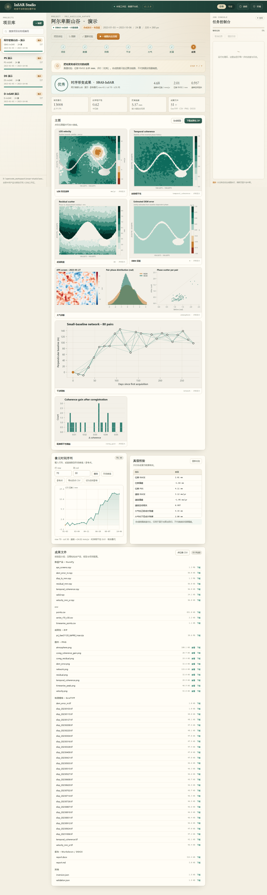

# InSAR Studio 用户手册

本手册面向第一次接触 InSAR 的用户。按顺序做完「第一次跑通演示」一节，就能理解整个软件；后面的章节用于导入自己的数据、调参和排查问题。

> 需要从零开始、连下载和解压都不熟的操作步骤，请看 [新手指南](新手指南.md)。需要完整的影像类型说明、处理原理、分场景操作教程、参数表和常见问题，请看 [使用教程](使用指南.md)（V2.0）。本手册是更短的操作入口。

## 1. 安装与启动

### 1.1 环境要求

- Windows 10/11、Linux 或 macOS；
- Python 3.9 – 3.11（推荐 3.11，64 位）；
- 至少 4 GB 可用内存；处理真实大栈建议 16 GB 以上；
- 配准、干涉和反演开始前会估算峰值内存，明显超过可用内存时提前停止并给出缩减建议；容器或共享机器可用 `INSAR_MEMORY_BUDGET_BYTES`（如 `8G`）覆盖检测值；
- 首次安装依赖需要联网，之后可离线运行。

### 1.2 Windows 一键启动

双击项目根目录的 `start.bat`。脚本会：

1. 查找 Python（优先 3.11/3.10/3.9，再回退到 PATH 和更新版本）；可先用 `start.bat --check` 只检查环境与依赖；
2. 通过 `scripts/bootstrap.py` 检查 `numpy / scipy / scikit-image / matplotlib / flask / tifffile / python-docx / requests`；
3. 依赖缺失时自动创建项目内 `.venv` 并安装 `requirements.txt`（只需一次）；
4. 启动本地服务，从 `8765` 起自动选择空闲端口，并自动打开浏览器。

终端会打印实际访问地址。端口被占用时会自动顺延，不会启动失败。保持黑色命令行窗口打开；关闭窗口或按 `Ctrl+C` 即停止服务。

### 1.3 收到分享包

如果拿到的是 `insar-studio-1.2.0.zip` 分享包，按下面最短路径操作：

1. 先确认 ZIP 和同名 `.sha256` 文件在一起，按包内 `RELEASE.md` 的方法核对 SHA-256；
2. 解压到路径较短、没有特殊字符的本地目录，不要在压缩软件预览窗口里直接运行；
3. 先运行 `start.bat --check` 查看环境；只提示缺少依赖时继续双击 `start.bat` 自动安装，提示 Python 版本或 32 位问题时先安装 64 位 Python 3.11。Linux / macOS 对应 `bash start.sh --check` 和 `bash start.sh`；
4. 第一次启动会在包内创建 `.venv` 并安装依赖，需要联网；发布包不包含 `workspace/`，演示数据会在本机重新生成。

完整的校验、验收和已知限制见包内 `RELEASE.md`。

### 1.4 手动启动

```powershell
cd D:\path\to\insar-studio
python -m insar_studio serve --open
```

默认从 `8765` 起自动选择空闲端口，并输出实际地址，例如：

```text
InSAR Studio · http://127.0.0.1:8765
```

需要固定端口时使用 `--port 8765 --strict-port`（被占用时直接退出）；`--port 0` 表示由操作系统分配端口；`--no-browser` 不自动打开浏览器。

### 1.5 环境自检

点击页面右上角「环境」，或在终端运行：

```powershell
python -m insar_studio doctor
```

检查项包括 Python 版本、依赖包、SNAPHU（可选）、工作区写入权限和磁盘空间。SNAPHU 未安装不影响使用。

### 1.6 并发与请求限制

- 全局最多同时执行 2 个处理任务，超出的任务保持「排队」；可用环境变量 `INSAR_MAX_CONCURRENT_JOBS` 调整（1–32）。
- 同一项目仍然只允许一个活跃任务，重复提交返回 409。
- JSON 请求体默认上限 4 MiB，可用 `INSAR_MAX_JSON_BYTES` 调整；GACOS 上传另限 512 MiB。
- 页面和 API 带有基础安全响应头与 CSP，API 响应不缓存；但软件没有登录和权限系统，默认只监听本机。

## 2. 界面总览



| 区域 | 作用 |
| --- | --- |
| 左侧「项目库」 | 搜索、分页加载、切换、新建、删除项目；显示路线、影像数和完成进度 |
| 顶部栏 | 引导/专家模式切换、「?」帮助、「环境」自检 |
| 项目标题区 | 当前项目的数据源、时间范围、影像数、尺寸；刷新、项目体检、重新校验、一键跑完 |
| 七步导航 | 项目 → 数据 → 网络 → 干涉 → 大气 → 反演 → 成果 |
| 中间内容区 | 当前步骤的说明、指标、图件、参数和操作按钮 |
| 右下任务控制台 | 进度、阶段、日志；运行任务时自动展开，成功后自动收起 |

### 项目库分页

项目库默认每页显示 60 个。项目较多时，点击列表底部的「加载更多」继续加载；在搜索框输入名称或项目 ID 后，会在服务端过滤并自动刷新。当前打开的项目即使不在第一页，也会保留在侧栏，不会被任务刷新隐藏。

### 引导模式与专家模式

- **引导模式**（默认）：只显示最常用的参数，适合第一次使用。
- **专家模式**：显示全部参数，包括基线阈值、滤波窗口、正则化、APS、PS/DS 阈值等。

切换模式不会改变已有参数，只影响显示。

### 任务控制台

- 点击标题栏展开/收起；窄屏下是右下角抽屉。
- 任务运行时自动展开，成功结束后自动收起；失败时保持展开。
- 「清空日志」只清空显示，不影响项目数据。
- 同一项目同时只允许一个处理任务；运行期间重复提交会被拒绝，并提示已有任务在运行（HTTP 409）。
- 全局同时执行的任务数默认是 2，超出的任务显示「排队」，前一个结束后自动开始。
- 可在控制台点「取消任务」；刷新页面后如果任务仍在运行，页面会自动重连并继续显示进度。

## 3. 第一次跑通演示

1. 启动后，左侧项目库选择「SBAS 演示」。
2. 点击顶部「7 成果」；如果项目已处理完，会直接看到速率图。
3. 点击「一键跑完全流程」，确认覆盖提示。
4. 观察控制台依次显示：配准 → 网络 → 干涉 → 大气 → 反演。
5. 完成后页面自动跳到「成果」，控制台显示「已完成」。
6. 查看：
   - 速率中位数、位移 RMSE（演示数据）；
   - 速率图、时序相干性图、残差图；
   - 点击任意图件放大；
   - 输入行列查询时间序列，或点「形变峰值」「参考点」；
   - 导出像元时间序列 CSV 或点位表 CSV；
   - 「生成报告」「下载成果包 ZIP」（可选精简或完整）。

如果左侧还没有项目，欢迎页的「用演示数据跑一遍」会创建一个 SBAS 演示项目并自动运行全流程，完成后可直接查看成果。

演示数据已知真值，所以成果页会显示「优秀/良好/需检查」的自动评价。真实数据没有真值，这一栏会提示不可用。

### 3.1 然后跑两个真实案例

演示跑通后，建议按顺序做两个真实案例。数据和结果已经随仓库提供，不需要注册数据账号：

1. [定日 2025 地震 D-InSAR](../examples/01_dingri_2025_dinsar/)：两景、500 × 500，几分钟得到同震 LOS 形变图。重点看 D-InSAR 的参考点、去趋势开关和相位压缩说明。
2. [白格滑坡 SBAS](../examples/02_baige_landslide_sbas/)：41 历元、51 × 95，走完整网络和 SBAS 反演。重点看时序参数、重建时间轴和绝对速率的限制。

两个案例都有 Web 界面逐步教程和 `scripts/run_case.py` 一条命令版本。入门顺序和常见坑见 [新手指南](新手指南.md) 第 7、8 节。

## 4. 新建项目

点击项目库右上角「+ 新建」。

### 4.1 演示项目

- 输入名称；
- 选择 SBAS / PS / DS / D-InSAR；
- 点「创建演示项目」。

系统会生成 24 景、220 × 260 像元的合成 SLC 栈，包含形变、大气、DEM 误差和配准偏移。生成后不会自动处理，需要到「成果」页点「一键跑完全流程」或逐步运行。

### 4.2 导入项目

- 选择「导入本地数据」；
- 填写数据目录，或单个 `.npz` 文件路径；
- 可选填 DEM 路径；
- 如果 SLC 已在 SNAP/ISCE 等工具中完成配准，勾选「导入的 SLC 已经配准」；
- 创建后到「数据」步骤确认栈信息。

在已有项目里重新导入时，界面会先做一次只读预检，显示景数、尺寸、地理参考、验证级别和全部警告；确认后才会覆盖当前栈。预检默认只读文件头与最多 4M 像元的抽样数据（小栈会覆盖全量），正式导入仍会完整校验全部像元，因此预检通过不代表跳过最终检查。

支持的数据组织方式见[第 6 节](#6-导入自己的数据)。

### 4.3 项目保存在哪里

```text
workspace/projects/prj_xxxxxxxx_xxxxxx/
```

每个项目一个目录，包含 `project.json`、`data/`、`interferograms/`、`products/`。复制整个目录即可迁移；删除项目会删除目录，请先备份。

## 5. 七步操作详解

### 5.1 项目

这一页显示项目概况和参数摘要。常用操作：

- **刷新**：重新读取磁盘上的产品状态。
- **项目体检**：只读检查数据、参数指纹、配准、网络、干涉、大气、反演、报告与磁盘空间；任务运行期间会提示已有任务。
- **重新校验**：对演示数据重新计算真值指标。
- **一键跑完全流程**：依次运行五个处理阶段，已有产品会被覆盖。
- **重置处理结果**：清空干涉、大气、反演与导出成果，保留原始影像和配准结果。
- **删除项目**：在项目卡片菜单中操作（不可恢复）。

切换到 PS/DS/D-InSAR 时，系统会自动套用该路线合适的默认值（如 PS 多视=1、最大时间基线=96 天）。手动改过的参数不会被覆盖。

路线切换或重跑某个阶段时，系统会先清理该阶段的下游产品，避免旧干涉图、旧大气或旧反演结果混入新成果。如果只改了参数但没有重跑，项目体检会把对应阶段标记为「参数待重跑」。

### 5.2 数据

演示项目会显示：

- 振幅预览（时间平均）；
- 日期列表、平台、轨道方向；
- DEM、掩膜、真值存在性；
- 数据源标记「合成演示」。

导入项目在这一页可以：

- 重新导入或补导 DEM；
- 查看预检警告、验证级别（`full`/`sampled`/`header`）、日期、文件与尺寸；
- 检查有效像元比例和地理参考状态。

**检查清单**：

- 预检警告逐条都能解释，并确认验证级别符合预期（`sampled`/`header` 时正式导入会完整校验）；
- 日期数量与预期一致；
- 行列尺寸与 DEM 一致；
- 掩膜没有大面积误删；
- 振幅图不是全黑/全白/纯噪声；
- 没有地理参考时，确认成果只按像元坐标使用。

### 5.3 网络

点击「生成干涉网络」或直接运行下一步。系统会：

1. 检查 `data/processed/slc_coreg.npy`；不存在则先自动配准。导入时标记为 `already_coregistered` 的栈会直接复用，不再二次配准。
2. 按路线生成干涉对；
3. 检查日期图是否连通，不连通时补一条时间桥；
4. 超过最大对数时按短基线优先裁剪，同时保证每个日期至少出现一次。

页面会显示：

- 时间基线/垂直基线散点图；
- 干涉对列表（可按基线排序）；
- 连通分量、冗余度、最大时间基线。

**调参建议**：

- 形变快、植被多：减小最大时间基线（如 48–60 天），提高相干性；
- 地形起伏大：减小最大垂直基线（如 100–150 m），降低 DEM 误差敏感度；
- 对数太少：放宽阈值或提高 `max_pairs`。

### 5.4 干涉

选择干涉对，可以查看：

- 振幅；
- 缠绕相位；
- 滤波相位；
- 解缠相位；
- 相干性；
- 残差。

参数：

| 参数 | 建议 |
| --- | --- |
| 多视因子 | 演示默认 2；PS 用 1；低相干区可 4 |
| 相位滤波 | 默认 Boxcar 3×3；噪声大用 Goldstein；保留细节用 NL-Means |
| 解缠算法 | 默认质量引导；有 SNAPHU 可切换；连续低噪声可用最小二乘 |
| 相干性阈值 | 默认 0.18；噪声大时提高到 0.25–0.35 |

**常见问题**：

- 解缠相位出现大面积跳变：提高相干性阈值、换 Goldstein、减小多视。
- 相位全是噪声：检查配准和相干性；真实数据还要检查 burst 拼接。
- 处理很慢：减少干涉对数或增大时间基线阈值。

### 5.5 大气

三种方法：

1. **GACOS**
   - **官方 GACOS（真实项目默认）**：先在面板点「申请 GACOS 产品」，填写接收邮箱、输出格式、W/S/E/N 和 UTC 时/分。单次最多 20 个日期、范围最大 10°×10°；超过 20 个日期时勾选拆批，最多 3 批（60 景）。收到官方邮件后，点「导入邮件链接」粘贴 tar.gz 链接，或点「上传 tar.gz / 产品文件」选择附件或解压后的产品。邮箱只用于本次申请，不写入项目。
   - **本地**：填写包含 `.ztd/.rsc`、`.tif` 或 `.npy` 的目录；文件名必须包含日期（`YYYYMMDD` 或 `YYYY-MM-DD`）。适合已经手工下载好产品的场景。
   - **演示**：选「模拟 GACOS」，仅用于演示项目观察校正上限；真实项目不要使用。
   - **自定义在线**：填写服务地址、邮箱/令牌。它不是 GACOS 官方接口，不同部署接口不同，需自行确认。
2. **经验高程**
   - 不需要外部数据；用相位—高程稳健回归扣除分层大气。
   - 适合地形起伏明显、无 GACOS 的场景。
3. **不校正**
   - 保留原始相位，由反演阶段的时间高通处理残余 APS。

官方 GACOS 面板要看四个状态：

- **覆盖率**：例如「18 / 24 天 · 75%」。只有 100% 才能跑大气阶段。
- **缺失日期**：显示还缺哪些日期，按这些日期补导产品。
- **最近申请 / 最近导入**：确认邮件是否已提交、产品是否已进入项目。
- **过期提示**：如果产品是在大气结果生成后才导入，阶段会标记为需要重跑；重新运行大气即可。

诊断图怎么看：

- 左侧逐日 APS 屏：空间纹理是否合理，量级是否异常；
- 中间相位分布：校正后分布应更集中；
- 右侧逐对散点：点应更靠近 1:1 线。

校正过度会让速率图出现大面积负相关纹理，或把真实长波形变当成大气扣掉。此时回退到「不校正」或只用经验高程。

### 5.6 反演

选择或确认：

- 是否估计 DEM 误差（默认关闭；有可靠 DEM 且垂直基线跨度大时可开）；
- 是否去线性/二次 ramp（默认开；会移除真实长波形变，慎用）；
- 参考像元模式（默认自动）；
- 正则化强度（默认 0.30；噪声大时提高，形变细节丢失时降低）；
- APS 迭代次数（默认 1）。

点击「运行反演」。完成后显示：

- 速率中位数、有效像元比例；
- 时序相干性中位数；
- 反演残差；
- 参考像元位置。

### 5.7 成果

成果页分为：

1. **评价卡**：技术路线、参考像元、速率/位移中位数、RMSE、空间相关。
2. **统计卡**：有效像元、时序相干性、残差/相干性、成果文件数。
3. **主图**：速率/位移、相干性、残差、DEM 误差、大气、网络、配准增益。点击放大。
4. **像元时间序列**：输入行列，或点「形变峰值」「参考点」；可导出当前像元 CSV。
5. **真值校验**：仅演示数据。
6. **成果文件**：按类型分组，可单独下载；另有像元 CSV 与点位表 CSV。
7. **报告与 ZIP**：生成 Markdown + DOCX；下载成果包时可选择“成果包”（精简，只含成果）或“完整包”（另含原始栈、干涉图和中间产品）。

## 6. 导入自己的数据

### 6.1 最简 NumPy 栈

目录结构：

```text
my_stack/
  slc.npy
  dem.npy        # 可选
  mask.npy       # 可选
  meta.json      # 可选但强烈建议
```

- `slc.npy`：`complex64`，形状 `(n_dates, rows, cols)`；
- `dem.npy`：`float32`，`(rows, cols)`，单位米；
- `mask.npy`：`bool`，`(rows, cols)`，True 为有效；
- `meta.json`：日期、平台、轨道、基线、入射角、像元间距；强烈建议同时给出 `corner_lon`、`corner_lat`、`lon_step`、`lat_step`。缺少 `bperp_m` 时，可提供每景 `start_times` 和 `orbit_dir`，由本地 Sentinel-1 `.EOF` 精密轨道估计垂直基线。若希望反演后自动输出地图坐标，还需提供 `start_times`、`azimuth_time_interval`、`range_spacing_m`，以及 `slant_range_time_s` 或显式 `slant_range_m`。
- 如果整栈已经配准，可在 `meta.json` 中写 `"already_coregistered": true`，或在界面勾选对应选项；流水线会跳过二次配准。

也可以把同一组数组打成一个 `.npz`，直接把这个文件填进导入路径：

```text
stack.npz
  slc     # complex64, (n_dates, rows, cols)，必需
  dem     # float32, (rows, cols)，可选
  mask    # bool, (rows, cols)，可选
  dates   # 字符串数组，可选
  meta    # JSON 字符串，可选
```

`dates` 优先取 `dates` 数组，其次取 `meta["dates"]`；缺失日期按 12 天间隔补齐。导入时按日期升序重排影像，并同步重映射 `bperp_m` 与 `ref_index`，不需要手动改参考景。

导入后在「数据」页检查尺寸、日期和预检警告。没有 `bperp_m` 时，垂直基线全为 0，DEM 误差估计自动失效；缺少日期时系统会补齐，但会明确标记为推断日期；缺少地理参考时会提示成果使用像元坐标。缺少轨道或几何时间字段时，反演仍可完成，但不会生成地图坐标 GeoTIFF。

### 6.2 GeoTIFF 栈

把每景复数 GeoTIFF 放在同一目录，文件名包含日期（如 `20230103.slc.tif`）。系统按文件名排序并解析日期。所有影像必须同尺寸、同网格；不同尺寸会被裁到最小公共范围，不建议依赖这个行为。

### 6.3 ENVI 栈

提供 `.hdr`（以及同名 `.dat/.img`）。系统读取 ENVI 头中的行列、数据类型和波段数。复数 ENVI 栈需要正确的 `complex64` 数据类型。

### 6.4 Sentinel-1 SAFE

实验性支持单 swath、已配准的复数 int16 TIFF。导入时会读取 `annotation` 中的首行时间、入射角和像元间距，可用于本地 EOF 轨道估计垂直基线。生产级 TOPS 数据仍请先在 SNAP/ISCE 中完成：

- TOPS 配准与 burst 拼接、去斜；
- 干涉图或 SLC 栈导出。

如果 .SAFE 同目录或父目录中有 Sentinel-1 `.EOF`，导入器会读取轨道状态向量；反演后可在几何元数据齐全时输出地图坐标 GeoTIFF。没有轨道时仍可处理，但成果只保留雷达坐标。

### 6.5 数据质量检查

导入后至少确认：

1. 振幅图有纹理，不是纯噪声；
2. 日期顺序正确，没有重复/缺失，推断日期有明确警告；
3. 掩膜保留主要陆地，水体/阴影被剔除；
4. 相邻日期干涉相位连续，没有整体跳变；
5. DEM 与 SLC 同网格、同单位；
6. 项目体检中的「地理参考」和「预配准栈」状态符合预期。

## 7. 下载 Sentinel-1

「数据」步骤的下载面板支持：

### 7.1 Copernicus Data Space

- 输入邮箱、密码；
- 设置 bbox（西、南、东、北）、起止日期、最大结果数；
- 搜索后选择产品下载；
- 凭据只用于当前请求，不写入项目文件；引擎摘要、作业记录、报告和 ZIP 落盘前会统一脱敏。

### 7.2 ASF DAAC

- 搜索公开；
- SLC 下载需要 Earthdata 用户名和密码；
- 大文件建议用官方客户端。

下载的是原始产品，仍需 SNAP/ISCE 预处理后才能导入。下载目录在 `workspace/cache` 或项目 `data/downloads` 下。

## 8. 参数速查

### 8.1 网络

| 参数 | 作用 | 调大 | 调小 |
| --- | --- | --- | --- |
| `max_temporal_baseline` | 最大时间基线 | 对数多、覆盖好，但相干性下降 | 相干性好，但对数少 |
| `max_perpendicular_baseline` | 最大垂直基线 | 对数多，但 DEM 误差敏感 | 对 DEM 误差不敏感，但对数少 |
| `max_pairs` | 最大干涉对数 | 更稳健，更慢 | 更快，可能不连通 |
| `min_coherence` | 有效像元阈值 | 结果干净，覆盖少 | 覆盖多，噪声大 |

### 8.2 干涉与解缠

| 参数 | 作用 | 建议 |
| --- | --- | --- |
| `multilook` | 多视 | 演示 2；PS 1；低相干 4 |
| `filter` | 滤波 | Boxcar 稳；Goldstein 保边；NL-Means 慢但细腻 |
| `boxcar_size` | 滤波窗口 | 3–5；太大糊掉细节 |
| `unwrap_coherence_min` | 解缠阈值 | 0.18–0.35 |
| `remove_ramp` | 去趋势 | 默认开，按 `ramp_order` 去平面或二次趋势；有真实长波形变时关 |

### 8.3 反演

| 参数 | 作用 | 建议 |
| --- | --- | --- |
| `regularization` | 时间正则 | 0.1–0.5；噪声大提高 |
| `robust_iterations` | 稳健重加权 | 3–5 |
| `estimate_dem_error` | DEM 误差联合估计 | 默认关；基线跨度大且 DEM 可靠时开 |
| `aps_iterations` | 残余 APS | 1–2；过多会吃掉形变 |
| `reference_mode` | 参考像元 | auto 最省心 |

### 8.4 PS / DS

| 参数 | 作用 |
| --- | --- |
| `ps_adi_max` | PS 振幅离差阈值，越小点越少越稳 |
| `ps_coherence_min` | PS 时序相干性阈值 |
| `ds_patch` | DS 相干/协方差窗口大小，越大越平滑 |

补充说明：

- 原始 SLC 和配准输出使用内存映射，干涉按行块多视、参考像元流式统计、去 ramp 按行块相减；PS 振幅离差按行块流式累计，DS 局部协方差按行块计算，单块缓存不超过 256 MiB（约 268 MB）；不再保留全量相干矩阵。
- 大栈仍应为多视后的 SLC、DS 链接相位和特征分解预留内存；DS 特征分解时间随景数立方增长。任务开始前的内存估算会拦截明显超出机器容量的配置，但不会预留内存，也不替代真实压测。
- 阈值过严导致 PS 候选点为 0 时，反演会明确报错并提示放宽 `ps_adi_max`、`ps_coherence_min` 或检查振幅和有效掩膜，不会伪造点。

## 9. 成果解读

### 9.1 速率图

- 颜色单位 mm/yr，正值表示朝向卫星（LOS 向）；
- 大片平滑色块通常是真实形变或大气残余；
- 细碎斑点通常是噪声或低相干；
- 边缘异常条带可能是配准/去斜残余。

### 9.2 时序相干性

- 越接近 1 越稳定；
- 低于 0.3 的区域慎用；
- PS 路线会额外显示 PS 点掩膜。

### 9.3 残差

- 观测相位与模型预测之差；
- 中位数越小越贴合；
- 局部大残差可能是解缠错误、形变非线性或大气未校正。

### 9.4 DEM 误差

- 与垂直基线相关的相位误差；
- 关闭估计时输出接近 0；
- 开启后若出现与地形高度相关的大范围条纹，说明 DEM 或基线有问题。

### 9.5 真值校验

只对合成演示有效。指标包括位移 RMSE、偏差、P95、速率 RMSE、速率空间相关、成对大气残差。评价阈值用于回归，不是真实数据精度承诺。

### 9.6 地理编码

反演完成后，如果参考轨道和几何元数据齐全，系统会把速率、时序相干性、DEM 误差和逐日位移重采样到 EPSG:4326 北向上网格，写入：

- `products/geotiff/geo/`：地图坐标 GeoTIFF；
- `products/geocode.json`：状态、覆盖率、网格、输出文件、查找表块数/线程数/耗时和降级原因。

大网格（例如 5000×5000）会自动按行分块并用最多 4 个线程求解，约需 90 秒和 400 MB 以上额外内存；输出数组本身会随网格线性增长。`status` 为 `done` 或 `partial` 时可以直接在 QGIS/ArcGIS 中打开；`unavailable` 或 `failed` 时按 `reasons` 补齐元数据后重跑反演。该实现不做投影变换、严格正射校正、跨 180° 经线处理或 TOPS burst，精度取决于轨道和 DEM。

## 10. 报告与交付

点击「生成报告」会生成：

- `products/report/report.md`：纯文本，便于版本管理；
- `products/report/report.docx`：可直接交付。

报告包含项目概况、数据、网络、干涉、大气、反演、真值校验和成果清单。

「下载成果包 ZIP」会先显示两种模式的体积和文件数：

- **成果包（精简，推荐分享）** `*_insar_results.zip`：只含 `project.json` 和 `products/`，包括 `arrays`、`geotiff`、`csv`、`figures`、`report` 和 `geocode.json`。不含原始 SLC、配准栈、干涉图和大气产品。
- **完整包（归档/换机复现）** `*_insar.zip`：在精简包基础上加入 `data/stack`、`data/network.json`、`data/processed/coreg.json`、`data/atmosphere` 和 `interferograms`。

两种包都跳过 `products/exports/` 自身，不会递归打包旧 ZIP。体积显示为未压缩合计，实际 ZIP 通常更小；导出在请求内同步生成，项目较大时需要稍等。

## 11. 排查问题

### 启动失败

1. `python --version` 是否为 3.9+；
2. `python -m insar_studio doctor` 看缺哪个包；
3. 端口是否被占用（默认会自动顺延到空闲端口；使用 `--strict-port` 时会直接失败）；
4. 工作区是否有写权限；
5. 路径是否包含特殊字符（建议全英文路径）。

### 页面空白或按钮无反应

1. 强制刷新（`Ctrl+F5`）；
2. 看浏览器控制台是否有 JS 报错；
3. 确认服务窗口没有报错；
4. 版本升级后旧缓存可能残留，刷新即可。

### 任务失败

1. 展开任务控制台看最后一条错误；
2. 检查数据是否已导入、网络是否生成；
3. 检查磁盘空间；
4. 用 `doctor` 确认依赖完整；
5. 演示项目可删除后重建，排除数据损坏。

### 处理结果异常

- 速率整体偏移：检查参考像元；
- 速率图大面积条纹：检查配准、去斜、DEM；
- 相位跳变：提高相干性阈值或换滤波；
- 形变被“抹平”：降低正则化、关闭去 ramp、减少 APS 迭代；
- 噪声大：提高相干性阈值、增加多视、使用 Goldstein/NL-Means。

### 性能

- 演示 24 景全流程耗时（本机 2026-11-07 回归）：SBAS 约 16.5 秒、PS 约 33.1 秒、DS 约 17.4 秒、D-InSAR 约 3.2 秒；
- 真实数据随像元数、干涉对数近似线性增长；DS 特征分解时间随景数立方增长；
- 大栈建议：先降采样/多视，分块处理，关闭不必要的图件输出。

## 12. 备份与迁移

- 备份：复制 `workspace/projects/<id>` 整个目录；
- 迁移：把目录放到新机器的 `workspace/projects/` 下，重启服务；
- 只迁移成果：复制 `products/` 和 `project.json`；
- 清理：删除项目会删除整个目录，不可恢复；
- 日志与缓存：`workspace/logs`、`workspace/cache` 可安全清理。

## 13. 术语表

| 术语 | 含义 |
| --- | --- |
| SLC | 单视复数影像 |
| IFG | 干涉图 |
| SBAS | 小基线集 |
| PS | 永久散射体 |
| DS | 分布式散射体 |
| APS | 大气相位屏 |
| GACOS | 通用大气延迟产品，官方申请后通过邮件导入 |
| LOS | 雷达视线向 |
| RMSE | 均方根误差 |
| 相干性 | 两景相位质量的相似性度量 |
| 解缠 | 把缠绕相位恢复为连续相位 |
| 垂直基线 | 两景轨道在垂直于视线方向的距离 |
| 时间基线 | 两景成像时间差 |

---

如果手册没有覆盖你的问题，先运行 `python -m insar_studio doctor`，再查看任务控制台的完整日志。大多数失败都能从最后一条错误定位到数据、依赖或参数。

---

本手册对应 **InSAR Studio 1.2.0**。版本号可在页面右上角版本标识或 `python -m insar_studio doctor` 中核对。
